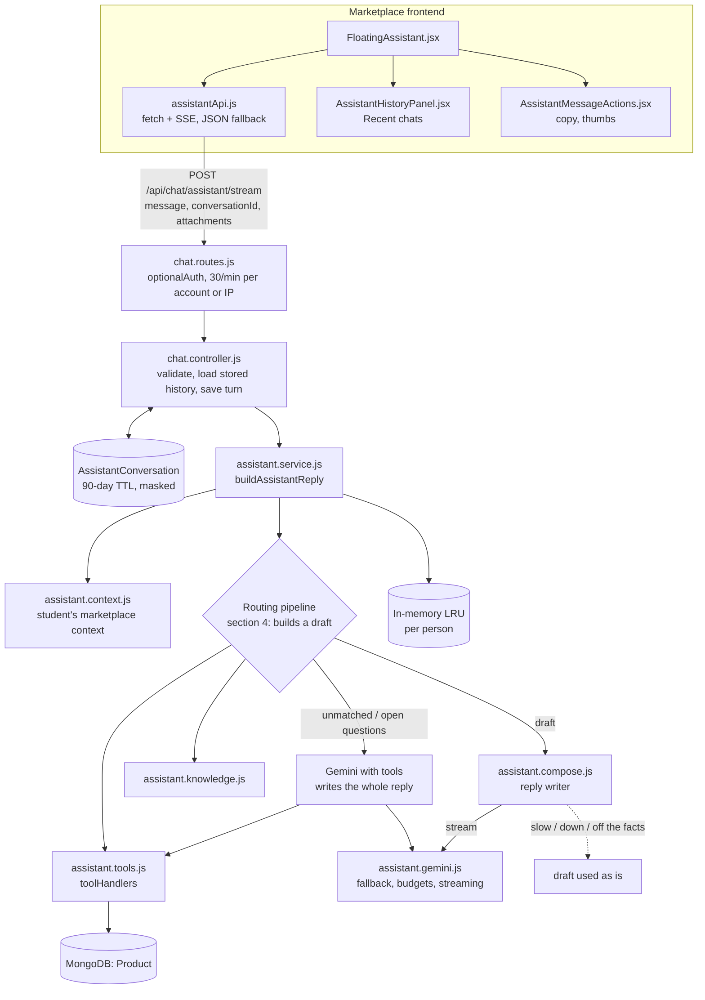

# Unideals AI Assistant: Architecture & Behaviour

This describes the student-facing chatbot ("Unideals AI", the floating assistant on the marketplace site) **as it works today**, after Phases 0, 1 and 2. Its known gaps are covered at the end. Code references name the file and function, because line numbers move.

**Contents**

1. [What it does](#1-what-it-does)
2. [Architecture at a glance](#2-architecture-at-a-glance)
3. [Request and response contract](#3-request-and-response-contract)
4. [The routing pipeline](#4-the-routing-pipeline)
5. [The reply writer](#5-the-reply-writer)
6. [The Gemini layer](#6-the-gemini-layer)
7. [Knowledge base](#7-knowledge-base)
8. [Image and voice](#8-image-and-voice)
9. [Chat history and feedback](#9-chat-history-and-feedback)
10. [Caching, limits, errors and privacy](#10-caching-limits-errors-and-privacy)
11. [Side endpoints](#11-side-endpoints)
12. [Configuration](#12-configuration)
13. [Known gaps and roadmap](#13-known-gaps-and-roadmap)
14. [Testing](#14-testing)

---

## 1. What it does

A chat panel, available on every marketplace page except `/chat`, `/login`, `/signup` and `/forgot-password`. With it a student can:

| Capability | Example | Where the facts come from |
| --- | --- | --- |
| Find listings | "cycle under 3000", "do you have a calculator" | Direct product search with price parsing; result cards |
| See what's popular | "Show trending items" | Most boosted, most viewed and newest listings |
| Sell something | "help me sell my Hero cycle" | Listing draft plus a price hint from similar campus listings |
| Price check | "what's a fair price for a used kettle" | Median of matching live listings |
| Recommendations | "suggest books for 1st year" | Category recommendation (several searches) |
| Trip packing | "what should I carry for a trek" | Checklist matched against what is listed on campus |
| Platform help | "how do boosts work", "can I sell medicines" | Knowledge base answer with steps and a link |
| Plan prices | "how much is Pro" | Live plan pricing for this user |
| Safety | "is advance UPI payment safe" | Knowledge base or safety tips |
| Photo search | upload or take a photo | Gemini identifies the item, then a product search |
| Voice search | hold to record (up to 60 s) | Gemini transcribes, then a product search |
| Small talk | "hi", "thanks", "bye", "how are you" | A short friendly line |
| General buying advice and anything unmatched | "is a 2019 MacBook fine for coding?" | Gemini with tools; it answers related questions and warmly redirects unrelated ones |

In every row except the last, **the code gathers the facts and Gemini writes the words** (section 5). The student gets a short reply in their own language (English, Hindi or Hinglish), personalised with their own marketplace activity, streamed word by word. If Gemini is slow or down, the app's own wording is used instead.

**Guests vs signed-in users.** Both can use it. The routes use `optionalAuth`.

| | Guest | Signed in |
| --- | --- | --- |
| Replies | Neutral greeting, no personal context | First name (sometimes), campus, plan and boosts left, own listings with views, wishlist count, open deals |
| History | Browser tab only (`sessionStorage`) | Saved on the server for 90 days; "Recent chats" across devices |
| Feedback | Copy button only | Copy, thumbs up / down |
| Girls Corner listings | Hidden | Shown when eligible |

---

## 2. Architecture at a glance



**Files**

| File | Role |
| --- | --- |
| `frontend/src/features/chat/components/FloatingAssistant.jsx` | Widget UI, streaming display, saved-chat id, image/camera/voice capture, result cards |
| `frontend/src/features/chat/api/assistantApi.js` | Streaming client (SSE over `fetch`, refresh-and-retry on an expired login, JSON fallback) and the history calls |
| `frontend/src/features/chat/components/AssistantHistoryPanel.jsx` | "Recent chats": open, delete one, delete all |
| `frontend/src/features/chat/components/AssistantMessageActions.jsx` | Copy, thumbs up / down |
| `backend/src/routes/chat.routes.js` | Assistant, stream, history and feedback routes; rate limits |
| `backend/src/controllers/chat.controller.js` | Validation, loading stored history, saving each turn, the SSE stream |
| `backend/src/services/assistant.service.js` | The routing pipeline (drafts), the tool-calling Gemini path, fallbacks, cache |
| `backend/src/services/assistant.compose.js` | The reply writer: persona, prompt, language choice, fact guard, chips |
| `backend/src/services/assistant.context.js` | The signed-in student's marketplace context (cached 60 s) |
| `backend/src/services/assistant.gemini.js` | Gemini calls: model fallback, time budgets, circuit breaker, streaming |
| `backend/src/services/assistant.tools.js` | Tool declarations for Gemini and their handlers (DB queries, policy data) |
| `backend/src/services/assistant.knowledge.js` | Main knowledge base (56 entries) and keyword matcher |
| `backend/src/config/knowledgeBase.js` | Structured policy data (terms, privacy, plans, guides) used by tools |
| `backend/src/services/assistantHistory.service.js` | Stored chats: load, history for the model, save a turn, list, delete, feedback |
| `backend/src/models/AssistantConversation.model.js` | Chat storage schema, 90-day TTL index |
| `backend/src/utils/maskPersonalInfo.js` | Hides phone numbers, UPI IDs, emails, card and Aadhaar numbers before saving |

---

## 3. Request and response contract

### `POST /api/chat/assistant/stream` (what the widget uses) and `POST /api/chat/assistant` (JSON)

Both take the same body and produce the same reply object. The stream sends the reply text as it is written.

**Request**

```json
{
  "message": "cycle under 3000",
  "conversationId": "665f…",
  "history": [{ "sender": "user", "text": "..." }],
  "attachments": [{ "mimeType": "image/jpeg", "data": "data:image/jpeg;base64,..." }]
}
```

- **`message`** is required: a non-empty string of at most 2,000 characters.
- **`conversationId`** (signed-in only, optional): the saved chat to continue. Leave it out to start a new one. The server loads that chat's last 8 messages itself. **For signed-in users, any `history` the client sends is ignored**, so nobody can feed the model made-up "assistant" turns.
- **`history`** (guests only): the client's last 8 messages, as text.
- **`attachments`** are optional; only the first is used. Images are resized on the client to 1280 px JPEG; audio is `audio/webm`, up to 60 s. These two routes accept JSON bodies up to 5 MB; every other route gets 10 KB.

**Stream response** (`text/event-stream`):

```
event: delta
data: {"text":"Found a couple of good rides"}

event: done
data: {"success":true,"data":{ …the reply object… }}
```

- `delta` events carry the reply text in pieces. `done` always comes last with the **final** reply, which replaces whatever was streamed (it differs only if the writer failed mid-way or went off the facts).
- `event: error` with `{ message }` if the turn fails after streaming has started.
- Validation errors, an expired login and unknown chats are answered as plain JSON before any streaming starts (see the errors below).

**JSON response**: `200 { success: true, data }` with the same reply object.

**The reply object**

| Field | Meaning |
| --- | --- |
| `reply` | Markdown-ish text: `**bold**`, `*italic*`, bullet and numbered lines, `/route` links |
| `intent` | e.g. `conversation`, `product_search`, `knowledge_base`, `price_estimation`, `listing_creation`, `out_of_scope` |
| `suggestions` | Follow-up chips (up to 4 shown), written for this turn |
| `products` / `productCards` | Listing cards |
| `estimate`, `draft`, `comparison`, `checklist`, `bundle`, `safetyTips` | Rich cards rendered by the widget |
| `route`, `sources` | Link button and where the answer came from |
| `searchQuery`, `transcript`, `missingItems` | Extra data for the photo, voice and trip paths |
| `aiPowered`, `model` | Whether Gemini wrote the reply, and which model |
| `conversationId`, `messageId` | Signed-in only: the saved chat, and this reply's id (for feedback) |

**Errors**
- **400**: missing, empty, too-long or non-string message, or a non-string `conversationId`.
- **401** (stream only): `{ code: "TOKEN_EXPIRED" }` when the login cookie has expired. The widget refreshes the session and retries once; if that fails it answers as a guest. The JSON endpoint just treats an expired login as a guest.
- **404**: `conversationId` isn't one of this student's chats, or it has expired. The widget then starts a new chat and resends.
- **429**: more than 30 messages a minute per account (guests: per IP). JSON body.
- **500**: unexpected errors. Internal error text is never returned.

### History and feedback (signed-in only, 60 requests a minute)

| Route | What it does |
| --- | --- |
| `GET /api/chat/conversations` | The 30 most recent chats: `id`, `title`, `preview`, `messageCount`, `lastActiveAt` |
| `GET /api/chat/conversations/:id` | One chat in the widget's message shape, with listing cards and rich cards |
| `DELETE /api/chat/conversations/:id` | Delete one chat |
| `DELETE /api/chat/conversations` | Delete all of the student's AI chats |
| `PUT /api/chat/conversations/:id/messages/:messageId/feedback` | `{ value: "up" \| "down" \| null }` on an assistant reply |

Another student's chat id always gets a 404, never a 403, so ids reveal nothing.

---

## 4. The routing pipeline

`buildAssistantReplyForViewer` (in `assistant.service.js`) runs each turn in four steps:

1. **Cache**: the same person asked the same thing in the last 5 minutes. Follow-ups and media are never cached.
2. **Context**: `getViewerContext(user)` loads the student's marketplace context (section 5).
3. **Draft**: `buildDraftReply` picks the first matching path below and returns its facts as a draft.
4. **Writer**: unless Gemini already wrote the reply (the tool-calling path) or the draft is marked "don't rewrite", `composeReply` turns the draft into the final reply (section 5).

Draft paths, **in order**:

| # | Path | Trigger | Gemini? |
| --- | --- | --- | --- |
| 1 | **Small talk** (`isSmallTalk`) | The whole message is a greeting, thanks, goodbye, "ok" or "how are you" | Writer only, with a "just chatting" brief |
| 2 | **Unmatched messages** (`isSupportedAssistantMessage` is false) | No platform or marketplace words. A bare product name still searches. A prompt-injection phrase gets a fixed, friendly redirect and never reaches the model. Anything else goes to **Gemini with tools**, told to answer buying-related questions from common knowledge and to warmly redirect unrelated ones | Yes |
| 3 | **Plan pricing** (`isPlanPricingQuestion`) | A price word plus pro, plan, boost or subscription. Uses live `getPricingForViewer(user)` | Writer |
| 4 | **Follow-up search** | "cheaper", "under 500", "similar"… re-runs the previous user request | Writer |
| 5 | **Shared draft cache** | The same message's facts were computed recently (not personal) | Writer |
| 6 | **Photo or voice** (`buildMediaReply`) | An attachment is present | Identify or transcribe, then the writer |
| 7 | **Trending** (`isTrendingRequest`) | "trending", "popular" or "what's hot" with no specific product | Writer |
| 8 | **Direct search** (`isShoppingQuery`, `buildDirectSearchReply`) | A price limit, a shopping verb, or a short message of 4 words or fewer | Writer |
| 9 | **Sell / price check** | "help me sell…", "fair price for…" | Writer |
| 10 | **Category recommendation** | recommend/suggest plus books, electronics, hostel, bike or travel | Writer |
| 11 | **Trip packing** | A trip word plus need/carry/pack | Writer |
| 12 | **Availability** | "do you have / available / need" plus a known product noun | Writer |
| 13 | **Knowledge base fast path** | `findKnowledgeBaseAnswer` with medium or high confidence | Writer |
| 14 | **Circuit breaker** | Gemini was rate-limited in the last 60 s, so use `fallbackLocalSearch` | No |
| 15 | **Gemini with tools** (`answerWithGemini`) | Everything else | Yes, writes the whole reply |

`fallbackLocalSearch` is a further regex cascade, used when Gemini fails or is in cooldown: knowledge base, safety tips, inspection checklist, price estimate, listing draft, budget bundle, "contact support", product search, then a generic menu.

---

## 5. The reply writer

`assistant.compose.js`, **"facts from code, words from Gemini"**.

**Input**
- The draft:
  - its own wording;
  - the listing cards (title, price, condition, original price);
  - a fair-price estimate;
  - which cards and link buttons are shown;
  - the items that aren't on campus.
- The student's context, and the last 4 turns.
- The message itself.
- `Reply in: English | Hindi | Hinglish`, decided **in code** by `replyLanguage`:
  - Devanagari means Hindi;
  - common Hindi words written in Roman letters mean Hinglish;
  - everything else is English.
  - Left to itself, the model drifted into Hinglish for English questions because the context sounds Indian.

**Persona** (`PERSONA`, shared with the tool-calling prompt)
- A friendly senior on campus: warm, casual, 1–3 sentences.
- Uses the first name at most once, and not in every reply.
- At most one emoji.
- Never says "As an AI" and never recites a feature list.
- Rupee amounts use Indian grouping.

**Rules for the writer**
- Every price, number, listing, link, step and policy must come from the facts.
- Numbered steps stay numbered.
- It doesn't re-list the cards.
- It uses the student's context only when that genuinely helps, for example "you've got 1 boost left this month" when they ask about boosts.

**Output**
- The reply text, then a `@@CHIPS@@` line, then 2–4 follow-up chips in the student's language.
- While streaming, `markerFilter` holds back anything that could be the start of the marker, so the student never sees it.

**Guards**: the draft is used as is when:
- the writer is slow: no first words within 8 s;
- Gemini is down or rate-limited;
- the reply is empty, longer than 1,400 characters, or looks like JSON;
- the reply **names a ₹ amount that isn't in the facts, the student's message or their context** (`inventsPrices`).

**Student context** (`assistant.context.js`, signed-in only, cached 60 s per person)
- First name and campus name.
- Plan, and plan boosts left this month.
- Active listing count, plus the top 3 listings by views (title, price, views, boosted).
- Wishlist count.
- Open deals.

It never includes a phone number, email, address or anyone else's details.

---

## 6. The Gemini layer

`assistant.gemini.js` (routing, timeouts, health) and `assistant.groq.js` (the Groq adapter).

**Providers: Gemini first, Groq as the failsafe**
- Every AI call walks one chain of models: the Gemini models, then the Groq models (`groq:<model>`). A failure hands over to the next model within the turn's time budget, so an expired Gemini key, a used-up quota or an overload means Groq answers instead.
- Groq is reached over its OpenAI-compatible HTTP API with plain `fetch` (no SDK). `assistant.groq.js` translates Gemini-style requests (contents, system prompt, function tools, JSON mode) to OpenAI messages and back, so no caller changes.
- **Photos and voice notes stay on Gemini.** Groq is text only here; with Gemini down, media gets the "type the product name instead" reply.
- Groq's models are reasoning models: they're sent `reasoning_effort: "low"` with 512 extra tokens, and a note that a final JSON answer goes in the message text (gpt-oss otherwise tries to "call a tool named JSON"). An invalid tool call (`tool_use_failed`) is retried once as a plain answer.
- `node scripts/check-ai-providers.mjs` pings every model in the chain and lists the chat models your Groq key can use.

**Models**
- **Tool-calling path**:
  - primary `GEMINI_MODEL` (default `gemini-flash-latest`);
  - then `GEMINI_FALLBACK_MODELS` (default `gemini-flash-lite-latest`);
  - then `GROQ_MODELS` in order (default `openai/gpt-oss-120b`, `openai/gpt-oss-20b`).
- **Reply writer**: the fast Gemini model first, then the primary, then Groq **smallest first** (rewrites are the high-volume call, and each Groq model has its own per-minute token limit, so this spreads the load). Override the Gemini part with `GEMINI_COMPOSE_MODELS`.
- In November 2026 the free Groq key offered `openai/gpt-oss-120b`, `openai/gpt-oss-20b`, `qwen/qwen3.8-27b` and `allam-2-7b` (no Llama chat models). `gpt-oss-120b` was limited to 8,000 tokens a minute; a tool-calling turn uses about 2,000.
- In November 2026 the `-lite-latest` alias resolved to `gemini-3.5-flash-lite`.
- `thinkingBudget: 0` is **rejected** (400) by that model, so no thinking settings are sent.

**Timeouts**
- **Per call**: the smaller of `GEMINI_TIMEOUT_MS` and 9 s. The call is aborted with `AbortController`. Aborting frees our server, but Google may still bill the call.
- **Per turn**: 20 s across everything: tool rounds, model fallbacks and the writer.
- **Writer**: its first words must arrive within 8 s. Once text is flowing, it may continue until the turn's deadline (`streamGeminiWithFallback`, two clocks). A failure part-way through still ends with the `done` event carrying the draft.

**Errors** (`noteFailure`). None of them stops the chain: a problem with one provider is exactly when the other should answer.
- **Bad, expired or revoked key** (401, 403, or Gemini's 400 `API_KEY_INVALID`): that whole **provider** is paused for 10 minutes.
- **429 / `RESOURCE_EXHAUSTED`**: quotas are per model, so only that **model** is skipped: for the provider's own "try again in…" time (2–60 s), or 15 minutes when a daily quota is used up.
- **Timeout, 500, 502 or 503**: that model is parked for 2 minutes (still tried if nothing else is left).
- **404**: that model is parked for 30 minutes.
- **Anything else** (e.g. a 400 one model didn't like): the next model is tried.
- `isAIAvailable()` (exported as `isGeminiAvailable` too, for older callers) is true while any model in the chain can be called; when it's false, the app's own wording is used without waiting.

**Tool-calling path** (`answerWithGemini`)
- `temperature: 0.6`, `maxOutputTokens: 1024`.
- At most 2 tool rounds.
- Returns JSON `{ reply, intent, suggestions }`.

**System prompt** (`SYSTEM_PROMPT`)
- **Persona**: the shared persona.
- **Honesty rules**:
  - Unideals rules, prices and procedures come only from the knowledge base, the student context or tools;
  - an uncovered policy question gets one honest sentence pointing to hi@unideals.in or /contact;
  - general buying know-how may come from common knowledge, but must not be presented as an Unideals rule;
  - clearly unrelated topics get a warm one-line redirect.
- **The tool map**: which tool to call for which kind of question.
- **Platform basics**: the core facts the model can rely on.

Per request it also gets:
- the user's name and tier, and the student context;
- **the listings shown earlier in the chat, with their ids**, so "compare the first two" can call `compareTwoProducts`;
- at most one knowledge base entry;
- the `Reply in` line.

### Tools (`assistant.tools.js`)

| Tool | Reads | Notes |
| --- | --- | --- |
| `searchProducts` | Products | Regex per token over title, brand, category and description; 80 candidates re-scored in JS |
| `getProductDetails` | Products | By id or slug |
| `estimateFairPrice` | Products | Median, low and high of matching asking prices |
| `getTrendingProducts` | Products | Boosted first, then views, then newest |
| `compareTwoProducts` | Products | Returns both items |
| `getBudgetBundle` | Products | Cheapest item per category within the budget |
| `generateListingDraft` | none | Template draft |
| `getInspectionChecklist`, `getSafetyTips` | none | Static lists |
| `getPlatformGuide` | `STEP_BY_STEP_GUIDES` | How-to steps |
| `getTermsAndPolicies` | `TERMS_AND_CONDITIONS` | Section or full terms |
| `getPolicyOrProcedure` | Policy data | About 18 topics. Boost credits and add-on prices come from `config/boostPlans.js` and `config/boostAddons.js` |
| `getCategoryDemandStats` | Products | Declared but its result isn't used |

Every product query runs through `visibleListingFilter`: listed, non-deleted listings only, with girls-only listings hidden unless the viewer is eligible. The viewer is carried with `runWithViewer` (AsyncLocalStorage).

---

## 7. Knowledge base

There are two hand-written sources. **The PDF in `output/pdf/` is not used by the code**: it is an old design export and is out of date.

### 7.1 `services/assistant.knowledge.js` (the one users mostly see)

**Entries**
- 56 entries, each made with `makeEntry({ id, title, keywords[], answer, steps[], route, suggestions[] })`.
- Keywords mix English and Hinglish.
- Topics:
  - platform basics, account and sign-in;
  - terms, prohibited items, liability and moderation;
  - selling, buying, safety and scams;
  - deals and chat, plans and boosts;
  - profile, privacy, reviews and pickup;
  - the assistant itself, search, wishlist, notifications and support;
  - greetings.

**Matching** (`findKnowledgeBaseAnswer`)
- The query is normalised, lightly stemmed and has stop words removed.
- Scoring:
  - +10 for a matching multi-word phrase;
  - +6 for a matching single keyword;
  - +2 for each overlapping term.
- Only the single best entry above 6 is used.
- A score of 12 or more is **high** confidence; 8 or more is **medium**.

**What happens with the match**
- **High or medium**: the entry becomes the draft (`formatKnowledgeReply`), and the writer rewords it while keeping its steps and link.
- **Low**: the entry is passed into the Gemini prompt as context.

### 7.2 `config/knowledgeBase.js` (structured data for tools)

- `TERMS_AND_CONDITIONS`: 10 sections.
- `PRIVACY_POLICY`: 6 sections. It now explains how AI chats are stored.
- `REVIEW_RATING_POLICY`.
- `SUBSCRIPTION_PLANS`: descriptive text.
- `STEP_BY_STEP_GUIDES`: 12 guides.
- `UNKNOWN_QUESTION_FALLBACK`.

### 7.3 How to update it today

1. Edit the entry in `assistant.knowledge.js`, or the data in `config/knowledgeBase.js`.
2. Add keywords people actually type, including Hinglish.
3. Run `node scripts/test-policy-knowledge.mjs`, and add a test case for the new entry.
4. Redeploy the backend.

Plan prices must **not** be copied into the knowledge base. Live prices come from `getPricingForViewer` and `config/subscriptionPlans.js`.

---

## 8. Image and voice

**Image**
1. The widget resizes the photo, or captures one from the camera, and sends it as a base64 data URL.
2. `buildMediaReply` asks Gemini (temperature 0.1, JSON output) for a search query.
3. It runs up to 8 candidate searches (the full phrase, word pairs, then single words) and ranks the results.
4. The writer phrases the reply.

**Voice**
1. `MediaRecorder` records `audio/webm` for up to 60 s.
2. Gemini transcribes it and turns it into a search query.
3. The reply quotes what it heard.
4. For signed-in students, **the transcript** is saved as the student's message, not the internal "please transcribe" prompt.

**On failure** the student gets a "try a clearer image / shorter recording" message. Error details are only logged on the server.

**Photos and recordings are never stored.** A saved chat only records that one was sent.

---

## 9. Chat history and feedback

**Signed-in students** (`AssistantConversation`)
- **What a conversation holds**: `user_id`, `title` (from the first message, masked), `messages[]`, `message_count` and `last_active_at`.
- **What each message holds**:
  - `role` and `text` (masked);
  - `media` (`image`/`audio`/null);
  - `intent`, `ai_powered`, `model` and `latency_ms`;
  - a snapshot of up to 6 listing cards (id, title, price, image, condition);
  - `extras` (chips, estimate, draft, checklist, route…), so a reopened chat looks the same;
  - `feedback` and `feedback_at`.
- **Masking before saving** (`maskPersonalInfo`): emails, UPI IDs, Indian mobile numbers, and 12–19-digit card, Aadhaar or account numbers become `[… hidden]`. Prices such as ₹3000 are left alone.
- **Retention**:
  - a TTL index deletes a chat **90 days after its last message**;
  - each chat keeps at most its last 200 messages.
- **Every turn**: the controller loads the chat (404 if it isn't the student's), passes its last 8 messages and recently shown listings into the pipeline, then appends both new messages. Saving never fails the reply.
- **In the widget**:
  - the current chat id lives in `sessionStorage` (`unideals-assistant-conversation`), tied to the signed-in user's id;
  - **Recent chats** (header button) lists, opens and deletes chats, and has "Delete all my AI chats";
  - every finished reply has **copy**, and saved replies also have **thumbs up / down**;
  - "New chat" starts a new saved chat; the old one stays in Recent chats.
- **Account deletion**: both the self-service `deleteAccount` and the admin `deleteUserPermanently` remove the student's AI chats.

**Guests**
- Nothing is stored on the server.
- Messages live in React state, mirrored to `sessionStorage` (`unideals-assistant-chat`, last 30 messages, image previews removed).
- The last 8 are sent with each request.

**Follow-ups**
- "cheaper" and "under 500" reuse the most recent request.
- For signed-in students, the listings shown in recent replies are given to the tool-calling model with their ids, so "compare the first two" can be resolved.

---

## 10. Caching, limits, errors and privacy

**Cache**
- In-memory LRU: 120 entries, 5-minute TTL, per server process.
- **Final replies are cached per person** (user id, or "guest"), because they can mention the student's name, listings or plan.
- **Shared entries** hold only facts (search results, knowledge base drafts), which are rewritten for each person.
- Only replies that Gemini wrote are cached, so a moment of Gemini downtime doesn't pin template replies for 5 minutes.
- Follow-ups and media are never cached.

**Rate limits**
- **Assistant (both endpoints)**: 30 messages a minute **per account**, guests per IP. A whole campus can sit behind one IP, so an IP limit alone would throttle everyone. Configurable with `ASSISTANT_RATE_LIMIT_PER_MINUTE`.
- **History routes**: 60 a minute.
- **Enhance-listing and negotiate**: 10 a minute.
- All limits return JSON.

**Errors**
- Almost every failure falls back to a local answer.
- Validation errors return 400.
- Internal error messages are never sent to the client.

**Privacy**
- **Sent to Google Gemini**:
  - the message, the recent history, and any photo or audio;
  - the student context (first name, campus, plan, own listings, counts);
  - the listings found.
- **Sent to Groq** (only when Gemini can't answer and `GROQ_API_KEY` is set): the same text as above, **never photos or audio**. The Privacy Policy's "Who we share it with" needs Groq added before this goes live.
- **Never sent**: phone numbers, emails, or other users' details.
- **Stored by Unideals**: signed-in chats only, masked, for 90 days.
- The Privacy Policy (`frontend/src/features/legal/content/legalContent.js`) covers this under "What we collect", "How we use it", "Who we share it with", "How long we keep it" and "Deleting your account".

---

## 11. Side endpoints

Both need a signed-in user and are limited to 10 requests a minute. **Neither is called by the frontend today.**

| Endpoint | Body | What it does |
| --- | --- | --- |
| `POST /api/chat/enhance-listing` | `itemDescription` (required, max 2,000), `condition`, `originalPrice`, `category` | Gemini (temperature 0.7) writes a title, description, suggested price and tags. Falls back to a simple template |
| `POST /api/chat/negotiate` | `askingPrice`, `offerPrice` (positive numbers), `userRole` (`buyer` or `seller`), `productId` | Gemini (temperature 0.5) gives 2–3 sentences of counter-offer advice |

---

## 12. Configuration

| Variable | Default | Purpose |
| --- | --- | --- |
| `GEMINI_API_KEY` | none | Required for every AI path. Without it, all replies come from templates |
| `GEMINI_MODEL` | `gemini-flash-latest` | Primary model for the tool-calling path |
| `GEMINI_FALLBACK_MODELS` | `gemini-flash-lite-latest` | Comma-separated models tried in order |
| `GEMINI_COMPOSE_MODELS` | fallbacks, then the primary | Models for the reply writer, fastest first |
| `GEMINI_TIMEOUT_MS` | `30000` | Per-call timeout, capped at 9 s by the service (applies to Groq calls too) |
| `GROQ_API_KEY` | none | Turns on Groq as the failsafe provider. Without it, the chain is Gemini only |
| `GROQ_MODELS` | `openai/gpt-oss-120b,openai/gpt-oss-20b` | Groq models tried in order after Gemini. Check what your key offers with `node scripts/check-ai-providers.mjs` |
| `ASSISTANT_RATE_LIMIT_PER_MINUTE` | `30` | Assistant messages per account (guests: per IP) per minute |

---

## 13. Known gaps and roadmap

**Done in Phase 0**

| Problem | Fix |
| --- | --- |
| Cache could serve one student's personalised AI reply to another | Replies are cached per person |
| "hi", "thanks", "bye" were treated as product searches | Small talk is answered first |
| "Show trending items" searched for the word "trending" | It lists what's popular |
| Empty or bad input returned 500 | 400 with a readable message |
| The media error leaked internal text | Errors are logged on the server only |
| Hung Gemini calls kept running, and a turn could take about 54 s | Calls are aborted, with a 20 s turn budget |
| Enhance-listing crashed on a missing description | Fixed, inputs validated |
| The bot gave `support@campusmart.in` and similar | It gives `hi@unideals.in` |
| Boost prices and credits were hard-coded in the policy tool | Read from the plan config |
| Rate-limit responses were plain text | JSON |

**Done in Phase 1: human tone and personalisation**

| Problem | Fix |
| --- | --- |
| Fixed English templates with emoji | The reply writer rewords every draft in a friendly persona; templates are only the fallback |
| Hinglish promised but not delivered | The reply language is decided in code from the student's message |
| "I'm the Unideals assistant — I can help with…" for anything unmatched | Unmatched questions go to Gemini, which answers buying-related ones and warmly redirects unrelated ones. Manipulation attempts still never reach the model |
| "Never use general knowledge" | Common buying know-how is allowed; platform rules must still come from the facts |
| Personalisation was just name and plan | Campus, plan boosts left, own listings with views, wishlist, open deals |
| The reply appeared all at once after a wait | Streamed word by word (SSE), with typing dots until the first words |
| Same chips every time | Chips are written per turn, in the student's language |
| A rewrite could invent a price | Replies naming a ₹ amount that isn't in the facts are thrown away |

**Done in Phase 2: stored history and feedback**

| Problem | Fix |
| --- | --- |
| History lost when the tab closed | Saved for signed-in students, for 90 days after the last message; "Recent chats" across devices |
| Client could send fake "assistant" turns | The server rebuilds the history from storage |
| "compare them" couldn't find the listings | Shown listings are stored and given to the model with ids |
| No feedback | Thumbs up / down on saved replies; copy on all replies |
| No way to remove chats | Delete one, delete all; removed with the account |
| Personal details in stored text | Phone, UPI, email, card and Aadhaar numbers masked before saving; no media stored |
| Campus NAT shared one rate limit | Limited per account |

**Still open: the roadmap**

| Phase | Gap | Plan |
| --- | --- | --- |
| 3 | The knowledge base needs a code change to edit | `KnowledgeEntry` in MongoDB, edited from the admin portal in Markdown, import/export `.md`, audited, under its own Roles & Access section |
| 4 | Only one keyword-matched entry is ever used | Embeddings (`gemini-embedding-001`) with top-k retrieval; keywords kept as a fallback |
| 5 | No learning loop | Admin "Conversations" and "Knowledge gaps" views built on the stored chats and thumbs-down; AI-drafted answers that a person approves before publishing |
| 6 | Image use is search-only | Photo-to-listing draft, duplicate-photo check (pHash), SafeSearch on uploads, optional "find similar", optional second provider |
| 7 | No per-user daily quota or token tracking | Daily AI quota (guests lower), token logging. Latency and AI-vs-template are already stored per reply |

**Other limitations worth knowing**
- **Gemini latency varies a lot.** In live checks on 11 November 2026, the same short rewrite took anywhere from 1.2 s to 19 s. Some turns miss the writer's 8 s first-words window and get the app's plain wording instead. `latency_ms` and `ai_powered` on stored replies show how often this happens.
- Every reply now makes at least one Gemini call (the writer), so AI cost scales with messages. Phase 7's quota matters more now.
- About 10 overlapping regex routes run in a fixed order, so wording changes can send a question down the wrong path. For example, "Any advice for a nervous first time seller…" lands on category recommendation. The writer softens how this reads, but the facts still come from that path.
- Product search is regex-based (no text index). `estimateFairPrice` ignores condition and outliers.
- Rate limits, the circuit breaker, the cache and the context cache live in each process's memory, so they aren't shared across server instances.
- `productContext` is ignored.

---

## 14. Testing

| Command (from `backend/`) | What it covers |
| --- | --- |
| `node scripts/check-ai-providers.mjs` | Live: pings every Gemini and Groq model in the chain with the real keys, and lists the chat models the Groq key can use |
| `node tests/assistant.integration.test.mjs` | 29 HTTP tests with Gemini and Groq mocked (the real Groq key is blanked, so tests never call it). **Groq failsafe**: Groq writes the reply when Gemini is down (JSON, streaming, tool path with converted schemas), an expired Gemini key pauses Gemini, a rate-limited Groq model hands over to the next, both down still gives the app's answer, photos never reach Groq. The rest: **Phase 0**: small talk, trending, 400s, no cross-user cache leak, abort on a hung model. **Phase 1**: the writer rewrites with cards unchanged, the context is passed without contact details, an invented price is rejected, the draft is used when Gemini is down, the off-topic and injection handling, chips and language helpers, streaming (signed in and guest), the expired-login 401. **Phase 2**: saving with masking, guests never stored, server-side history beats client history, 404 for other people's chats, list and reopen, feedback, delete one and all, the 90-day TTL index, masking cases |
| `node tests/userDeletion.integration.test.mjs` | Also checks that account deletion removes the student's AI chats and leaves others' alone |
| `node scripts/test-policy-knowledge.mjs` | 30 knowledge base matching cases, 18 policy tool topics, the scope guard and live pricing |
| `node scripts/smoke-assistant.mjs` | Product-search smoke test; needs a MongoDB with data |

The integration tests use `mongodb-memory-server`. If the system temp drive is full, point `TEMP`/`TMP` at another drive before running them.
