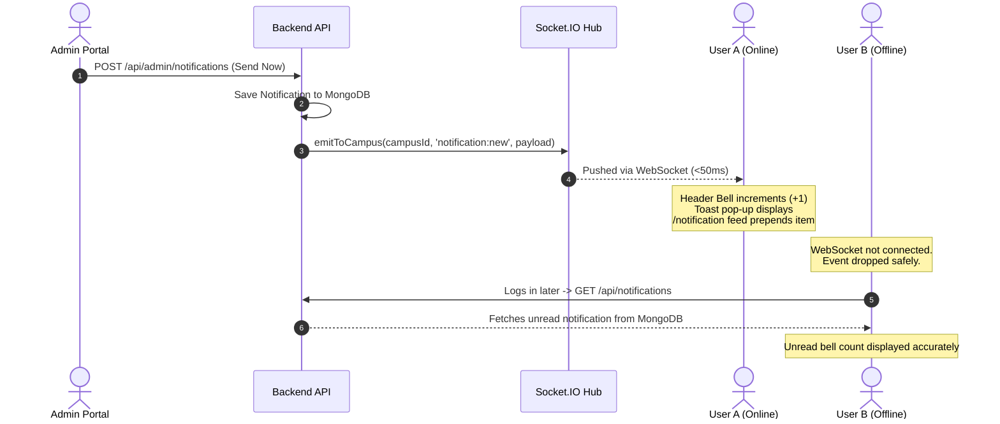

# Notification Feature Architecture & Event Trigger Specification

## 1. Executive Summary

UniDeals implements a **100% in-house, zero-external-broker real-time notification engine**. It connects three core application components:

1. **Admin Portal (`Campus-Mart-Admin`)**: Campaign creation, audience filtering, live preview, scheduled broadcasts, and deliverability analytics.
2. **Backend Engine (`Campus-Mart/backend`)**: Mongoose data models, Socket.IO rooms and real-time push dispatch, node-cron background schedule runner, and recipient resolution engine.
3. **Main User Marketplace (`Campus-Mart/frontend`)**: Real-time WebSocket listeners, header bell counter, profile sidebar badge, floating toast alerts, and interactive `/notification` inbox.

---

## 2. High-Level System Architecture

```mermaid
flowchart TD
    subgraph TriggerSources [Notification Triggers]
        T1[Admin Portal Broadcast / Schedule]
        T2[Chat Message sent in conversation]
        T3[Deal / Order Status Transition]
        T4[Wishlist / Price Drop Alert]
        T5[Moderation / Safety Actions]
    end

    subgraph BackendEngine [Backend Processing]
        T1 & T2 & T3 & T4 & T5 --> Core[notification.service.js]
        Core --> DB[(MongoDB: Notification & NotificationReceipt)]

        Cron[node-cron: * * * * *] -->|Every minute| Core

        Core --> TargetEngine[Recipient & Room Engine]
        TargetEngine --> Sockets[Socket.IO Server]
    end

    subgraph Rooms [Socket.IO Broadcast Rooms]
        Sockets -->|emit to user:id| R1[Single User Private Room]
        Sockets -->|emit to campus:id| R2[Campus-Scoped Room]
        Sockets -->|emit to broadcast:all| R3[All Connected Clients]
    end

    subgraph ClientUI [Main Marketplace Website]
        R1 & R2 & R3 --> Listener[useNotificationSocket / Realtime Listener]
        Listener --> Bell[Header Bell Badge +1]
        Listener --> Toast[Floating Toast Popup]
        Listener --> Feed[/notification Inbox Card Feed]
        Listener --> Side[Profile Menu Badge]
    end
```

---

## 3. Technology Stack & Design Decisions

| Layer                   | Technology                             | Architecture Rationale                                                                                     |
| ----------------------- | -------------------------------------- | ---------------------------------------------------------------------------------------------------------- |
| **Data Persistence**    | MongoDB + Mongoose                     | Fast document queries, indexing on campus/roles, dual model for broadcasts vs direct receipts.             |
| **Real-time Push**      | WebSockets via `socket.io` (v4.8+)     | Sub-50ms push delivery to online clients without HTTP polling overhead.                                    |
| **Task Scheduling**     | `node-cron` (v3.0+)                    | Lightweight, runs in-process every minute to check and trigger scheduled campaigns without RabbitMQ/Redis. |
| **Client UI**           | React 19 + Tailwind CSS + Lucide Icons | Responsive layout, dark/light mode compatible, instant preview matching admin creation controls.           |
| **Infrastructure Cost** | **$0 / Zero Third-Party Dependencies** | No Firebase Cloud Messaging, OneSignal, Pusher, Novu, or external queue clusters required.                 |

---

## 4. When Notifications Are Triggered ("Event Trigger Matrix")

Below is the complete specification of **every scenario when a notification is created**, who receives it, and what actions are taken.

| #      | Trigger Event                       | Trigger Source                                    | Target Audience                                           | Notification Type                        | Badge                                | Title & Message Template                                                                                                                         | Action CTA                                                                  |
| ------ | ----------------------------------- | ------------------------------------------------- | --------------------------------------------------------- | ---------------------------------------- | ------------------------------------ | ------------------------------------------------------------------------------------------------------------------------------------------------ | --------------------------------------------------------------------------- |
| **1**  | **Admin Instant Broadcast**         | Admin clicks "Send Notification" in Admin Portal  | • All Users<br>• Specific Campus<br>• Buyers<br>• Sellers | `promotion` / `announcement` / `general` | `OFFER` / `ANNOUNCEMENT` / `GENERAL` | **Title**: As configured by admin<br>**Body**: Custom announcement message<br>**Image**: Attached promotional banner                             | `[Action Label ↗]` → Configured target URL (e.g., `/deals`, `/product/:id`) |
| **2**  | **Admin Scheduled Broadcast**       | Cron runner executes at `scheduled_at`            | • Selected Audience<br>• Selected Campus                  | `promotion` / `announcement` / `general` | `OFFER` / `ANNOUNCEMENT`             | Dispatched automatically when schedule time arrives                                                                                              | Configured URL                                                              |
| **3**  | **Direct Chat Message**             | User sends message in active conversation         | Conversation recipient (`receiverId`)                     | `message`                                | `DIRECT MESSAGE`                     | **Title**: `New message from {Sender Name}`<br>**Body**: Excerpt of message text<br>_(Suppressed if recipient is already inside that chat room)_ | `[Reply in Chat ↗]` → `/chat?conversationId={id}`                           |
| **4**  | **New Deal Offer**                  | Buyer makes an offer on a listed item             | Seller of the product (`seller_id`)                       | `order`                                  | `ORDER UPDATE`                       | **Title**: `New Offer Received!`<br>**Body**: `{Buyer Name} offered ₹{Amount} for {Product Title}`                                               | `[View Offer ↗]` → `/chat?conversationId={id}`                              |
| **5**  | **Offer Accepted / Deal Confirmed** | Seller accepts offer / deal agreed                | Buyer (`buyer_id`)                                        | `order`                                  | `ORDER UPDATE`                       | **Title**: `Offer Accepted!`<br>**Body**: `{Seller Name} accepted your offer for {Product Title}. Schedule pickup now.`                          | `[View Deal ↗]` → `/myorders`                                               |
| **6**  | **Pickup Spot Scheduled**           | Either party proposes/confirms pickup spot & time | Counterparty                                              | `order`                                  | `ORDER UPDATE`                       | **Title**: `Pickup Spot Confirmed`<br>**Body**: `Meeting scheduled at {Spot Name} on {Date & Time}`                                              | `[View Pickup ↗]` → `/myorders`                                             |
| **7**  | **Item Received & Deal Completed**  | Buyer confirms item inspected & received          | Seller (`seller_id`)                                      | `order`                                  | `ORDER UPDATE`                       | **Title**: `Deal Completed Successfully 🎉`<br>**Body**: `{Buyer Name} confirmed receiving {Product Title}. Payment balance updated.`            | `[View Order Details ↗]` → `/myorders`                                      |
| **8**  | **Deal Cancelled**                  | Either party cancels active deal                  | Counterparty                                              | `order`                                  | `ORDER UPDATE`                       | **Title**: `Deal Cancelled`<br>**Body**: `Deal for {Product Title} was cancelled by {Name}`                                                      | `[View Details ↗]` → `/myorders`                                            |
| **9**  | **Price Drop Alert**                | Seller reduces price of a listed item             | Users who saved item to **Wishlist**                      | `promotion`                              | `OFFER / PROMO`                      | **Title**: `Price Drop Alert!`<br>**Body**: `{Product Title} dropped by ₹{Diff}. Grab it before it sells out!`                                   | `[Buy Now ↗]` → `/product/{id}`                                             |
| **10** | **Listing Moderation Warning**      | Admin/System flags listing for safety violation   | Product Owner (`seller_id`)                               | `general`                                | `GENERAL`                            | **Title**: `Listing Under Review`<br>**Body**: `Your listing for {Product Title} has been flagged for moderation review.`                        | `[Review Guidelines ↗]` → `/productlisted`                                  |
| **11** | **Support Role Assigned**           | Admin promotes a user to Support role             | Assigned User                                             | `general`                                | `GENERAL`                            | **Title**: `Staff Role Updated`<br>**Body**: `You have been granted Support permissions on UniDeals Admin Portal.`                               | `[Open Admin Portal ↗]` → `/dashboard`                                      |

---

## 5. Database Schema & Data Models

### A. `Notification` Model (Campaigns & Direct Events)

Stored in MongoDB collection: `notifications`

```javascript
{
  _id: ObjectId,
  title: String,             // Max 100 chars, required
  message: String,           // Max 500 chars, required
  type: String,              // "general" | "promotion" | "order" | "announcement" | "message"
  target_audience: String,   // "all" | "buyers" | "sellers" | "campus"
  target_campus: ObjectId,   // Ref: "Campus" (indexed)
  image_url: String,         // Optional ImageKit or remote banner URL
  action_url: String,        // Deep-link (e.g. "/deals", "/chat?id=123")
  action_label: String,      // CTA text (e.g. "View Offers", "Reply in Chat")
  schedule_type: String,     // "now" | "scheduled"
  scheduled_at: Date,        // If scheduled, execution timestamp (indexed)
  status: String,            // "draft" | "scheduled" | "sent" | "cancelled"
  sent_by: ObjectId,         // Ref: "User" (Admin or Sender ID)
  is_broadcast: Boolean,     // true = global/campus campaign; false = 1-to-1 event
  recipient_id: ObjectId,    // Target user (when is_broadcast === false)
  is_read: Boolean,          // Read status for 1-to-1 notifications
  is_dismissed: Boolean,     // Hidden from the recipient's feed
  read_at: Date,             // Timestamp when 1-to-1 was read
  stats: {
    total_sent: Number,      // Target recipient count
    delivered: Number,       // Active users reached
    clicked: Number          // Click interactions recorded
  },
  createdAt: Date,
  updatedAt: Date
}
```

### B. `NotificationReceipt` Model (Broadcast Read & Click Tracking)

Stored in MongoDB collection: `notificationreceipts`

Allows millions of broadcast reads without cloning whole notification payloads into thousands of individual documents:

```javascript
{
  _id: ObjectId,
  notification_id: ObjectId, // Ref: "Notification" (indexed)
  user_id: ObjectId,         // Ref: "User" (indexed)
  is_read: Boolean,          // default: true
  is_dismissed: Boolean,     // default: false; per-recipient feed dismissal
  read_at: Date,
  is_clicked: Boolean,       // default: false
  clicked_at: Date
}
// Unique Compound Index: { notification_id: 1, user_id: 1 }
```

### C. Automatic Self-Cleaning (30-Day MongoDB TTL Index)

To prevent the database from filling up with old notifications:

- Both `Notification` and `NotificationReceipt` records expire after 30 days:
  ```javascript
  notificationSchema.index(
    { createdAt: 1 },
    { expireAfterSeconds: 30 * 24 * 60 * 60 }, // Automatically expires after 30 days
  );
  ```
- MongoDB's internal background thread automatically cleans up documents older than 30 days.

---

## 6. Endpoints & API Contract

### User Marketplace Endpoints (`/api/notifications`)

All routes require standard user authentication cookie/bearer token:

- **`GET /api/notifications`**
  - Fetches combined personalized feed: broadcast campaigns matching user's campus + direct notifications (messages, orders).
  - Returns: `{ success: true, data: Notification[], unreadCount: Number }`
- **`PATCH /api/notifications/:id/read`**
  - Marks single item as read (updates receipt or direct document).
- **`PATCH /api/notifications/read-all`**
  - Marks all visible items as read in bulk.
- **`POST /api/notifications/:id/click`**
  - Increments click analytics counter and records `is_clicked: true`.
- **`DELETE /api/notifications/:id`**
  - Dismisses a notification for the authenticated recipient (receipt-scoped for broadcasts).

### Admin Portal Endpoints (`/api/admin/notifications`)

Protected by role authorization:

- `admin` role has full permissions (create, schedule, cancel).
- `support` role has read-only access (stats, history, scheduled preview).

- **`POST /api/admin/notifications`** _(Admin only)_
  - Creates and dispatches instant notification, or schedules for later.
- **`GET /api/admin/notifications/stats`** _(Admin & Support)_
  - Returns `{ totalSent, delivered, deliveredPercent, clicked, clickedPercent, activeUsers }`.
- **`GET /api/admin/notifications/history?page=1&limit=20`** _(Admin & Support)_
  - Paginated list of sent campaigns with stats.
- **`GET /api/admin/notifications/scheduled`** _(Admin & Support)_
  - List of pending scheduled campaigns.
- **`PATCH /api/admin/notifications/:id/cancel`** _(Admin only)_
  - Cancels a pending scheduled campaign.
- **`GET /api/admin/notifications/estimate-recipients?target_audience=&target_campus=`**
  - Live estimate of recipients for form preview.

---

## 7. Socket.IO Real-Time Delivery Lifecycle



---

## 8. Anti-Spam & Smart Handling Features

1. **Active Chat Presence Awareness**:
   When a direct chat message is sent, the backend checks whether the recipient is already in that active chat room (`conversation:{id}`). If they are actively reading/typing in that chat, the bell notification is bypassed to avoid alert noise.
2. **Offline Resilience**:
   Users who are not online when a push event is broadcast will still receive it in their `/notification` feed the moment they next log in.
3. **Campus Partitioning**:
   Notifications sent with `target_audience: "campus"` are strictly delivered to students of that campus; students from other colleges will never receive irrelevant college-specific deals or alerts.
4. **Dynamic Recipient Preview**:
   Admins get real-time feedback on how many users will receive the notification before clicking "Send".

---

## 9. Future Roadmap & Extensibility

- **Browser Web Push API (Service Worker)**:
  Integrate Web Push Notifications so users receive desktop/mobile OS notifications even when the browser tab is completely closed.
- **Custom Notification Sound**:
  Audio chime toggle in User Settings when high-priority notifications (deals or messages) arrive.
- **Email Digest Option**:
  Daily/weekly email summary of unread notifications for inactive users.

# Notification System — Audit & Gap Analysis

## ✅ What Is Fully Built

| #   | Trigger                                | Status                                                                                            |
| --- | -------------------------------------- | ------------------------------------------------------------------------------------------------- |
| 1   | **Admin Instant Broadcast**            | ✅ Built & working — `createAdminNotification()` → Socket.IO emitToAll/emitToCampus               |
| 2   | **Admin Scheduled Broadcast**          | ✅ Built — `dispatchDueScheduledNotifications()` via cron job every minute                        |
| 3   | **Direct Chat Message**                | ✅ Built — `notifyNewMessage()` called in `message.service.js`, chat-room presence check included |
| —   | **Header Bell Badge**                  | ✅ Built — Socket.IO listener in `Header.jsx` increments count live                               |
| —   | **Toast on new notification**          | ✅ Built — `toast.info()` fires in Header on `notification:new`                                   |
| —   | **`/notification` Inbox Page**         | ✅ Built — full card feed with read/mark-all/click-track                                          |
| —   | **Mark Read / Mark All Read**          | ✅ Built — PATCH endpoints + service functions                                                    |
| —   | **Click tracking analytics**           | ✅ Built — POST endpoint increments `stats.clicked`                                               |
| —   | **Admin notification stats & history** | ✅ Built — GET endpoints for admin portal                                                         |
| —   | **30-day TTL auto-cleanup**            | ✅ Defined in schema                                                                              |

---

## 10. Current Implementation Status

The trigger-gap checklist above was previously reported as missing, but those entries are implemented and wired in the current code:

| # | Trigger | Current implementation |
| --- | --- | --- |
| 1–2 | Admin instant and scheduled broadcasts | Implemented through the admin notification API, recipient dispatch, Socket.IO, and the scheduled-dispatch job. |
| 3 | Direct chat message | Implemented in `backend/src/services/message.service.js`; suppressed while the recipient is in the conversation room. |
| 4 | New deal offer | Implemented in `backend/src/services/deal.service.js`; notifies the seller. |
| 5 | Offer accepted | Implemented in `backend/src/services/deal.service.js`; notifies the buyer who made the offer. |
| 6 | Pickup scheduled | Implemented in `backend/src/services/deal.service.js`; notifies the buyer. |
| 7 | Deal completed | Implemented in `backend/src/services/deal.service.js`; notifies the seller. |
| 8 | Deal cancelled | Implemented in `backend/src/services/deal.service.js`; notifies the other party. |
| 9 | Wishlist price drop | Implemented in `backend/src/services/product.service.js`; fans out direct alerts to wishlist owners. |
| 10 | Listing moderation action | Implemented in `backend/src/services/report.service.js`; notifies the seller when a product report is actioned. |
| 11 | Support role assignment | Implemented in `backend/src/services/admin.user.service.js`; notifies on a role change to support. |

The marketplace uses a single shared notification context for the header, profile navigation badge, and inbox. Broadcast receipts hold per-user read and dismiss state; direct notifications hold their own read and dismiss state. Admin delivery analytics count eligible recipients and currently connected eligible users rather than returning sample values.

The user marketplace and backend are present in this repository. The separate admin portal that consumes the `/api/admin/notifications` endpoints is not part of this repository, so its form, preview, and rendering cannot be verified here.

## 11. Remaining Roadmap

- **Browser Web Push API (Service Worker):** Deliver OS-level notifications when the site is closed.
- **Custom Notification Sound:** Add an opt-in sound control for high-priority notifications.
- **Email Digest Option:** Send periodic unread-notification summaries to inactive users.
