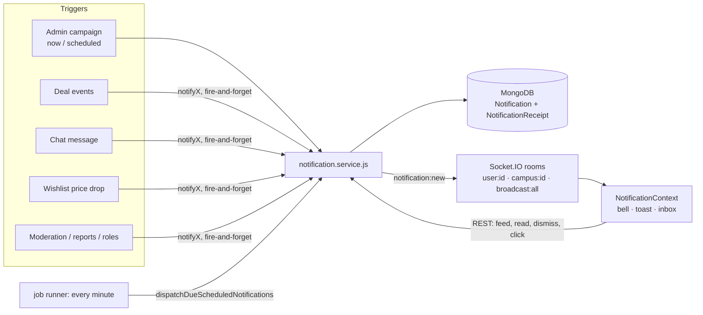

# Notification Architecture

Status as of 2026-11-11. Covers the backend engine and the marketplace web client in this repo. The admin portal (`Campus-Mart-Admin`) consumes `/api/admin/notifications` but lives in a separate repo.

## 1. What it is

An in-house, **in-app** notification system: MongoDB is the source of truth, Socket.IO pushes new items to users who are online, and the web client shows a header bell, a toast, and the `/notification` inbox. There is **no OS-level (system) push yet**. If the tab is closed, the user sees the item the next time they open the site. See [§8](#8-system-push-notifications-recommendation) for how to add it.



## 2. Code map

| Concern | File |
| --- | --- |
| Schema, retention, enums | `backend/src/models/Notification.model.js` |
| Engine (all logic) | `backend/src/services/notification.service.js` |
| User API | `backend/src/routes/notification.routes.js` → `controllers/notification.controller.js` |
| Admin API | `backend/src/routes/admin.routes.js` (`requireAccess("notifications", view/manage)`, campus-scoped) |
| Scheduler | `backend/src/jobs/dispatchScheduledNotifications.job.js` (every minute) |
| Socket rooms + emit helpers | `backend/src/sockets/index.js`, `backend/src/utils/socket.js` |
| Client state + realtime | `frontend/src/context/NotificationContext.jsx` |
| Icon/label/time/link helpers | `frontend/src/features/notification/utils/notificationMeta.js` |
| Inbox page / header dropdown | `frontend/src/features/notification/pages/Notification.jsx`, `frontend/src/components/layout/Header.jsx` |
| Tests | `backend/tests/notifications.integration.test.mjs` |

## 3. Two kinds of notification

| | Broadcast (campaign) | Direct (system event) |
| --- | --- | --- |
| Docs | 1 `Notification` per campaign | 1 `Notification` per recipient |
| `is_broadcast` | `true` | `false`, `recipient_id` set |
| Read / dismiss / click | per-user `NotificationReceipt` | fields on the doc itself |
| Who sees it | audience match (`all`, `campus`, `buyers`, `sellers`) **and** user joined before `sent_at` | the recipient |

**Lifecycle (`status`):** `scheduled → sending → sent`, plus `failed` and `cancelled`. Instant sends start at `sending`. The scheduler claims each due row atomically, so overlapping ticks or several instances never double-send. It also re-claims rows stuck in `sending` for more than 10 minutes (crash recovery), and marks a dispatch that throws as `failed` with a `failure_reason`.

**Retention:** a TTL index on `expires_at` = `sent_at` + 30 days. Rows still waiting to send have no expiry. Receipts use a 30-day TTL on `createdAt`.

**Grouping:** while a chat alert is unread, more messages in that conversation update the same row (`group_key`, `group_count`), e.g. "3 new messages from Sam", instead of stacking. Price-drop alerts allow one per user per product per 24h.

## 4. Event triggers

| Event | Recipient | Source |
| --- | --- | --- |
| Admin campaign (now / scheduled) | audience | `createAdminNotification`, scheduler |
| Chat message (skipped if the recipient has that chat open; grouped) | receiver | `message.service.js` |
| New offer | seller | `deal.service.js · makeOffer` |
| Offer accepted | offerer | `respondOffer` |
| **Offer declined** (new) | offerer | `respondOffer` |
| **Deal locked** (new) | buyer | `confirmDeal` |
| Pickup scheduled | buyer | `schedulePickup` |
| **Payment confirmed** (new) | buyer | `confirmPayment` |
| Deal completed | seller | `confirmItemReceived` |
| Deal cancelled | other party | `cancelDeal` |
| Wishlist price drop | wishlist holders | `product.service.js` |
| Listing blocked / hidden / deleted / auto-hidden / reinstated | seller | `moderation.service.js`, `report.service.js` |
| Report actioned (warning) | seller | `report.service.js` |
| Report outcome | each reporter | `moderation.service.js` |
| Promoted to support | user | `admin.user.service.js` |

Every `notifyX` helper is fire-and-forget and never throws, so a notification failure can't break the action that caused it.

## 5. API

User (`/api/notifications`, auth required):

| Method | Path | Does |
| --- | --- | --- |
| GET | `/` | Feed: up to 50 broadcasts + 50 direct, newest first, with `unreadCount` |
| PATCH | `/:id/read` | Mark one read |
| PATCH | `/read-all` | Mark all read |
| POST | `/:id/click` | Record a click (counted once per user) |
| DELETE | `/:id` | Dismiss for this user only |

Admin (`/api/admin/notifications`): `POST /` (manage), `GET /stats`, `GET /history`, `GET /scheduled`, `GET /estimate-recipients` (view), `PATCH /:id/cancel` (manage). Campus-limited staff can only target, and only see, their own campuses.

**Client payload** (feed rows and `notification:new` are the same shape, built by `toClientNotification`):

```js
{ id, kind,            // kind = raw type: message | order | price_drop | promotion | announcement | moderation | general
  type,                // display label kept for older clients: "DIRECT MESSAGE", "ORDER UPDATE", "PROMOTION", ...
  title, message, imageUrl, actionPath, actionLabel,
  count,               // >1 for grouped chat alerts
  createdAt,           // = sent_at
  unread, isBroadcast,
  /* legacy aliases, still sent: _id, description, image_url, action_url, action_label, time */ }
```

New client code should use `kind` and the camelCase fields. A socket push with an id the client already has replaces that row (this is how grouped chat alerts update).

**Links:** the server accepts in-app paths (`/deals`) or `https://` links. The client navigates in-app for paths, opens https links in a new tab, and sends anything else to the inbox.

## 6. Analytics semantics

- `total_sent`: active users in the audience at send time.
- `delivered`: of those, the users connected over Socket.IO at send time. It is not a real delivery receipt. Offline users still get the item in their feed.
- `clicked`: unique users who clicked, so click-through can't exceed 100%.

## 7. Known gaps / backlog

Ordered by impact.

1. **No system (OS) push.** Users who close the tab learn about offers, deals and messages only when they come back. This is the biggest product gap for a marketplace. See §8.
2. **No user preferences.** No per-category mute (e.g. turn off promotions but keep deal updates), no quiet hours, no unsubscribe. This is needed before push or email: without it, push opt-outs will be high.
3. **No email fallback or digest.** Resend is already a dependency (auth emails). An "unread for 24h → email" digest for deal events would recover inactive users.
4. **Single-instance realtime.** Socket.IO has no Redis adapter. With more than one backend instance, emits and `delivered` counts only cover users on the same instance. Add `@socket.io/redis-adapter` before scaling out.
5. **Missing triggers:** subscription expiring/expired, boost ending, new review on a seller, stale-deal follow-ups (`GET /api/deals/pending-followups` exists but nothing sends them), account suspension, role demotion or admin promotion.
6. **Feed has no pagination.** It is capped at 50 + 50 with no "load more", and there is no lightweight unread-count endpoint (the bell loads the whole feed).
7. **Campus room is fixed at connect time.** A user who changes campus keeps the old `campus:` room until they reconnect.
8. **Audience resolution for `buyers`/`sellers`** scans `distinct()` over all conversations/products. Fine now; precompute flags on `User` as data grows.

## 8. System push notifications: recommendation

**You can't fully build OS push in-house.** Every OS notification is delivered by the platform's push service: Google FCM (Chrome / Android), Apple APNs (Safari / iOS), Mozilla autopush (Firefox). What you own in-house is everything up to that hop: who gets notified, when, the content, preferences and token management.

| Option | What it is | Cost | Fits when |
| --- | --- | --- | --- |
| **Web Push (VAPID) + `web-push` npm** | Standard browser push. A service worker on the site, and the backend signs and sends to each browser's push endpoint. | Free | Web-only users. iOS works only when the site is installed to the home screen (iOS 16.4+). |
| **Firebase Cloud Messaging (`firebase-admin`)** | One API for web, Android and iOS (relays to APNs). | Free | You have, or will have, a mobile app. **Recommended.** |
| OneSignal | Hosted push + segmentation + dashboard. | Free tier, paid at scale | You want minimal code and accept a vendor holding user device data. |
| Novu (open source) / Knock / Courier | Full notification infrastructure: inbox, push, email, preferences, digests. | Novu self-host free; others paid | You'd rather replace the in-house engine than extend it. |

**Recommended path: keep the in-house engine and add a push channel on FCM.** The in-app engine already does the hard parts (triggers, audiences, scheduling, grouping), and FCM covers web and a mobile app with one integration at no cost.

In-house work needed:

1. `DeviceToken` model: `user_id`, `token`, `platform` (web/android/ios), `last_seen_at`. Endpoints to register and remove tokens. Remove on logout.
2. Web: `firebase-messaging-sw.js` service worker, plus a permission prompt shown after a meaningful action (first offer or first message), never on page load.
3. `NotificationPreference` on `User`: per-category on/off for in-app, push and email, plus quiet hours.
4. A channel dispatcher in `sendDirect` / `dispatchNotificationDocument`. After the DB write and socket emit, send push when the category allows it and the user is offline (or always for deal events). Use `sendEachForMulticast` for campaigns in batches of 500.
5. Prune tokens on FCM `registration-token-not-registered` errors. Rate-limit promotional campaigns per user.
6. Tap action: the push payload carries `actionPath`, and the service worker opens or focuses the site at that path.

Rough size: 1–2 weeks for one developer for web push with preferences. The mobile app adds its own SDK wiring on top.

## 9. Deploying this version

The retention change needs a one-off migration. Mongoose creates the new `expires_at` index but never drops the old `createdAt` TTL index, which would keep deleting scheduled campaigns:

```bash
cd backend && MONGO_URL=... node scripts/migrateNotificationExpiry.js
```

It is idempotent: it backfills `sent_at` / `expires_at` on existing rows, drops the legacy TTL index, then ensures the new indexes. Run it right after deploying.
